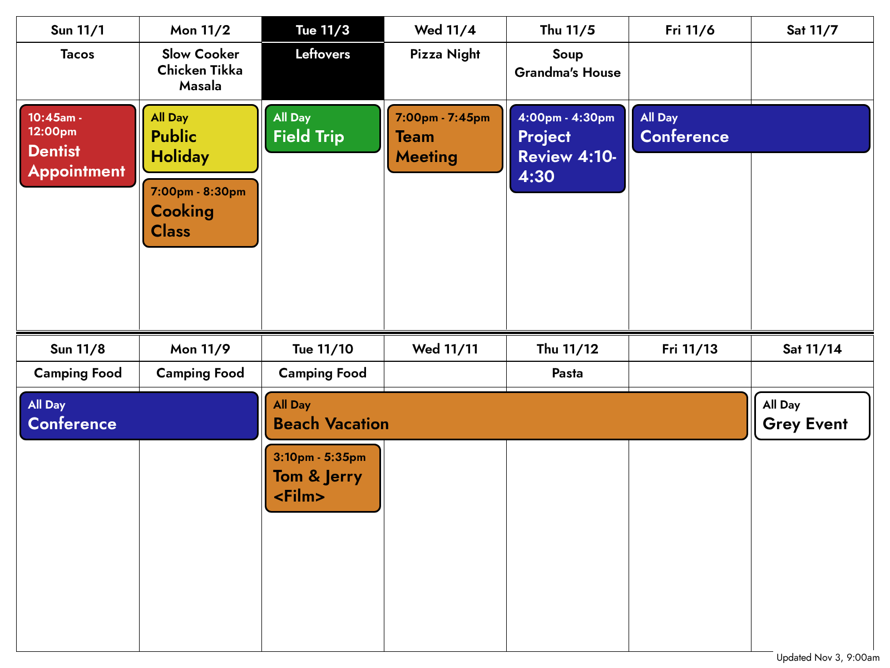

# InkyPi Google Calendar

An [InkyPi](https://github.com/fatihak/InkyPi) plugin that shows your Google Calendar on an e-ink display, keeping the colours you give individual events.



InkyPi's built-in Calendar plugin reads iCal feeds, which don't carry per-event colours. This plugin uses the Google Calendar API so they come through. It maps Google's colours to the panel's inks, and adds no Python packages, which keeps it light on a Pi Zero 2 W.

**Status:** new and in active development, built for a Raspberry Pi Zero 2 W with a 13.3" Inky Impression. Other hardware is untested.

## Install

Starting from a blank SD card, or running into trouble? The [full setup guide](docs/pi-zero-setup.md) covers the Pi, InkyPi and every awkward step in between.

If InkyPi is already running, on your Pi:

```bash
inkypi plugin install google_calendar https://github.com/kwbunker/InkyPi-google_calendar
```

## Set up Google access

This uses the [Google Calendar API](https://developers.google.com/workspace/calendar/api/guides/overview), which is free for personal use and needs no API key, only a sign-in. You set up your own small Google Cloud project, so no one else is involved in your access.

1. In the [Google Cloud Console](https://console.cloud.google.com/), create a project and enable the **Google Calendar API**.
2. Set up the **OAuth consent screen** as an External app. Publishing needs a home page and a privacy policy link, so on the Branding page you can use your own copy of this repo's page and its [PRIVACY.md](PRIVACY.md). Don't upload a logo, because that requires Google's verification.
3. **Publish the app to Production.** This matters: in Testing mode, [Google ends the sign-in every 7 days](https://developers.google.com/identity/protocols/oauth2#expiration). You don't need Google's verification for personal use, but you'll see a warning that the app isn't verified.
4. Create an **OAuth client** of type **Desktop app** and download its JSON file.
5. In InkyPi's web UI, open **Google Calendar**, choose that file, click **Update Now**, and reload the page.
6. Open the sign-in link and allow access. Your browser ends up on a `localhost` page that won't load, which is expected.
7. Copy the whole address from the address bar, paste it into the plugin's settings, click **Update Now**, and reload the page.
8. Choose your calendars, then add the plugin to a playlist with a refresh interval.

Two of those **Update Now** clicks show a message starting with "Error!" even though they worked, because that's the only way a plugin can show a message there.

The plugin only asks for read-only access. Your credentials and sign-in token stay on your Pi in `src/config/google_calendar/`, readable only by the InkyPi service, and they survive plugin reinstalls. See the [privacy policy](PRIVACY.md) for details.

## How it behaves

- **Refresh interval:** an hour is a sensible default. Each refresh asks Google for current events, and InkyPi only redraws the panel when the image actually changes.
- **Stale calendars:** a small "Updated" date in the corner shows when the calendar last refreshed, because an e-ink panel keeps showing its last image even if the Pi has stopped. It shows only the date, so it doesn't redraw the panel every hour.
- **Failures:** if a scheduled refresh fails, the panel keeps your last calendar. A problem that needs you, like an expired sign-in or no calendars selected, adds a red warning across the bottom straight away. A passing one, like a Wi-Fi drop, only adds it after 3 hours, so brief outages don't disturb the display. **Update Now** shows errors in the web UI instead. If only some calendars fail, the "Updated" text says how many.
- **Colours:** an event's own colour wins. Events with no colour use their calendar's panel colour, which the settings page suggests from the calendar's Google colour and lets you change. The page also lists which Google colours produce each panel colour. Orange isn't one of the 13.3" panel's inks, so it looks slightly grainy up close.

## Troubleshooting

- **Signed out after a week:** the app is still in Testing mode. Publish it to Production and sign in again.
- **Pi Zero 2 W won't join Wi-Fi on a mixed WPA2/WPA3 network:** this is a [Raspberry Pi OS bug](https://github.com/raspberrypi/linux/issues/7634), not this plugin. Add `brcmfmac.feature_disable=0x2282000` to `/boot/firmware/cmdline.txt`.

## Development

Run the tests from the repo root with Python, `requests`, `pytz` and `jinja2` available:

```bash
python -m unittest discover -s tests
```

`tests/render_sample.py` renders made-up events through the real template, with no Google account needed.

Based on the Calendar plugin in [InkyPi](https://github.com/fatihak/InkyPi), and licensed under the GPL-3.0 like InkyPi.
